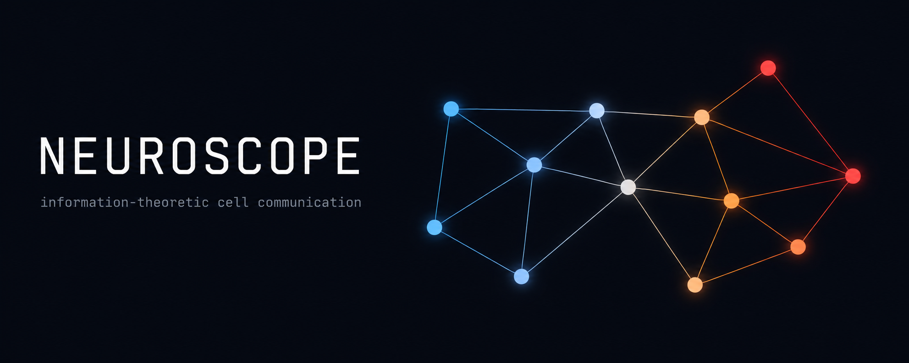

# NEUROSCOPE



**Information-theoretic cell-cell communication analysis for single-cell RNA-seq.**

NEUROSCOPE measures ligand-receptor signaling using KSG mutual information channel capacity instead of co-expression. The difference: co-expression methods check whether a ligand and receptor are both expressed in neighboring clusters. Channel capacity checks whether ligand variation across donors actually predicts receptor variation -- a stricter test that removes interactions with no measurable signal.

---

## Results

Benchmarked across four independent datasets spanning three diseases and two tissue types:

| Dataset | Donors | Significant pairs | Not detected by LIANA | Not detected by CellChat | AUROC |
|---------|--------|-------------------|-----------------------|--------------------------|-------|
| Kang 2018, IFN-beta PBMC | 16 | 5 / 9 | 3/5 (60%) | 3/5 (60%) | **1.000** vs 0.506 |
| COVID Blood Atlas, PBMC | 124 | 49 / 127 | 32/49 (65%) | 20/49 (41%) | **1.000** vs 0.506 |
| Perez 2022, SLE PBMC | 149 | 33 / 40 | 19/33 (58%) | 19/33 (58%) | **1.000** vs 0.506 |
| Smillie 2019, Crohn colon | 18 | 17 / 34 | 12/17 (71%) | 12/17 (70%) | **1.000** vs 0.506 |

AUROC comes from a synthetic ground-truth experiment (true-signal vs dead-receiver pairs). Co-expression scoring reaches 0.506 (chance) on all four datasets; KSG channel capacity reaches 1.000 on all four.

Full results are in [`results/NEUROSCOPE_figures.pdf`](results/NEUROSCOPE_figures.pdf).

---

## Why channel capacity

Most existing tools (CellChat, CellPhoneDB, LIANA) score `mean(ligand) * mean(receptor)` or a variant within a single sample. CellChat uses the trimean -- and when a gene is expressed in fewer than 50% of cells, the trimean is always zero, regardless of actual expression level. This is a mathematical property of the formula, not a threshold choice, so it cannot be fixed by tuning parameters.

NEUROSCOPE computes one mean per donor per cluster, then runs the KSG k-nearest-neighbor mutual information estimator on those paired vectors across donors. Inter-donor variation is real biological signal and survives even when individual cells are sparse.

Channel capacity = I(ligand; receptor) / H(ligand), normalized to [0, 1]. Significance is assessed by permutation test (199 shuffles) with BH-FDR correction. Confidence intervals use BCa bootstrap with 500 donor resamples.

---

## Installation

**MATLAB** (R2021b or later):
- Statistics and Machine Learning Toolbox
- Deep Learning Toolbox (optional -- used for NMF programs, falls back to PCA if absent)

**Python** (data preparation and comparisons):
```bash
pip install anndata scanpy scipy numpy pandas h5py fsspec
```

**R** (NicheNet comparison only):
```bash
Rscript scripts/install_nichenetr.R
```

CellPhoneDB reference tables are bundled in `converted/` -- no extra download needed to run the pipeline.

---

## Quick start

```bash
# Download and prepare the Kang 2018 dataset
python scripts/prep_kang2018.py

# Run the pipeline (from repo root)
matlab -batch "run('runs/kang2018.m')"
```

Results appear in `results/kang2018/`.

**Running on your own data:**

```matlab
config = struct();
config.dataset_name    = 'MyStudy';
config.expr_path       = 'path/to/expression.mat';    % sparse, cells x genes
config.metadata_path   = 'path/to/metadata.csv';      % needs CellID, Cluster, donor_id
config.cellphonedb_dir = 'converted';
config.output_dir      = 'results/mystudy';
config.n_permutations  = 200;
config.fdr_threshold   = 0.05;
config.run_ml          = false;   % set true for NMF programs and causal inference
config.random_seed     = 42;

NEUROSCOPE(config);
```

---

## Input format

**Expression matrix** -- a MATLAB sparse matrix (cells x genes) saved as `.mat` with variable name `expr_matrix`. The prep scripts in `scripts/` generate this from public H5AD files.

**Cell metadata** -- a CSV with one row per cell:

| Column | Required | Description |
|--------|----------|-------------|
| `CellID` | yes | Unique integer cell index |
| `Cluster` | yes | Integer cluster label (1-based) |
| `donor_id` | yes | Donor or patient identifier |

---

## Reproducing the benchmarks

```bash
# Kang 2018
python scripts/prep_kang2018.py
matlab -batch "run('runs/kang2018.m')"

# COVID Blood Atlas (Stephenson 2021)
python scripts/prep_covid_atlas.py
matlab -batch "run('runs/covid_atlas.m')"

# Lupus SLE PBMC (Perez 2022)
python scripts/prep_lupus.py
matlab -batch "run('runs/lupus.m')"

# Crohn colon (Smillie 2019)
python scripts/prep_smillie2019.py
matlab -batch "run('runs/smillie2019.m')"
```

**Comparisons against existing tools:**
```bash
# LIANA (wraps CellPhoneDB, CellChat, NATMI, Connectome)
pip install liana
python scripts/compare_liana.py

# NicheNet LR network membership
Rscript scripts/compare_nichenet.R
```

Expected runtimes on a standard laptop: Kang 3 min, Smillie 6 min, Lupus ~17 hr, COVID Atlas ~21 hr.

---

## Repository layout

```
NEUROSCOPE.m       main pipeline entry point
functions/         all pipeline modules (do not edit unless extending)
runs/              per-dataset configs -- edit these to change parameters
scripts/           data download, prep, and comparison scripts
converted/         CellPhoneDB reference tables (bundled, tracked)
results/           benchmark outputs, one subfolder per dataset
docs/              file inventory and cleanup notes
```

---

## Output files

Each dataset folder under `results/` contains:

| File | What it is |
|------|------------|
| `channel_rankings.csv` | All L-R pairs ranked by channel capacity |
| `*_specific_interactions.csv` | Differential channels (condition vs reference) |
| `*_specific_significant_only.csv` | FDR < 0.05 subset |
| `*_target_rankings.csv` | Ranked therapeutic targets |
| `*_science_report.txt` | Narrative summary with top interactions and confidence intervals |
| `comparison_liana_vs_neuroscope.csv` | Per-pair LIANA overlap |
| `comparison_cellchat_vs_neuroscope.csv` | Per-pair CellChat overlap |
| `comparison_nichenet_vs_neuroscope.csv` | NicheNet LR network membership |

Key columns in `channel_rankings.csv`:

| Column | Description |
|--------|-------------|
| `CondCapacity` | KSG channel capacity I(L;R)/H(L), range [0, 1] |
| `FDRCapacity` | BH-adjusted permutation p-value |
| `BootCI_lo/hi` | 95% BCa bootstrap confidence interval |
| `InformationScore` | Composite rank score |
| `CausalScore` | IV/2SLS causal estimate (NaN when donor count is too low) |

---

## Citation

> Ananda A. *NEUROSCOPE: Information-Theoretic Cell-Cell Communication Analysis via KSG Channel Capacity.* 2026.

---

## License

MIT. See [`LICENSE`](LICENSE).
